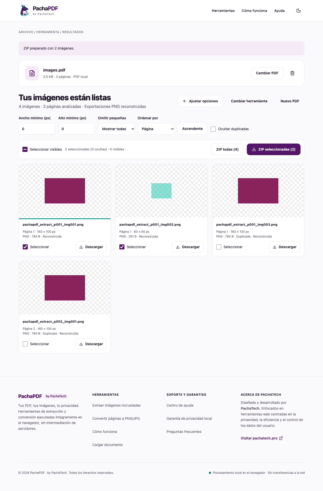
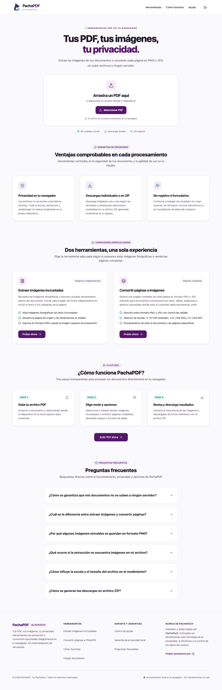
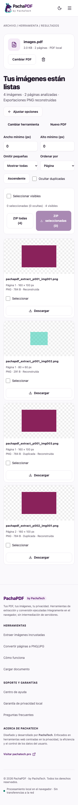

<div align="center">
  

# PachaPDF

**Tus PDF, tus imágenes, tu privacidad.**

Extrae imágenes incrustadas y convierte páginas PDF a PNG o JPG, directamente en tu navegador.

**Next.js · TypeScript · Tailwind CSS · shadcn/ui · PDF.js**

[Inicio rápido](#inicio-rápido) · [Arquitectura](#arquitectura) · [Pruebas](#calidad-y-pruebas) · [Documentación](#documentación)

Un producto de [PachaTech](https://pachatech.pro/).

</div>

## El proyecto

PachaPDF permite recuperar imágenes de documentos y exportar páginas completas sin enviar los archivos a un servicio de conversión. El usuario elige un PDF, configura la operación y descarga los resultados individualmente o en un ZIP. No necesita crear una cuenta.

El proyecto aborda retos de desarrollo frontend como procesamiento binario, integración de Web Workers, gestión de memoria, cancelación de tareas y validación de archivos. La aplicación se distribuye como sitio estático: el procesamiento del documento ocurre en el cliente.

## Vista previa



<details>
<summary>Ver la página de inicio y la experiencia móvil</summary>

### Inicio



### Resultados en móvil



</details>

Las capturas muestran la interfaz y documentos de prueba. Las imágenes obtenidas en la aplicación dependen del PDF que seleccione el usuario.

## Funcionalidades

| Área | Capacidades |
| --- | --- |
| Carga | Selección y arrastre de archivos, validación de firma y apertura, metadatos y contraseña local. |
| Extracción | Detección de objetos de imagen compatibles, exportación PNG, dimensiones y página de origen. |
| Conversión | Páginas completas a PNG o JPG, escala 1×/1.5×/2×, calidad JPG y selección por intervalos. |
| Galería | Miniaturas, filtros por dimensiones, detección de duplicados, orden y selección de resultados visibles. |
| Vista previa | Navegación entre imágenes, encajar o mostrar al 100 %, cierre con Escape y gestión de foco. |
| Descargas | Archivos individuales y ZIP de todos los resultados o de la selección, con nombres únicos. |
| Experiencia | Tema claro/oscuro, diseño responsive, progreso por páginas y cancelación cooperativa. |

### Extraer y convertir son operaciones diferentes

**Extraer imágenes** busca objetos raster incrustados en el PDF y los exporta como PNG a partir de los píxeles decodificados por PDF.js. Conserva las dimensiones del objeto en los casos compatibles; no garantiza recuperar el archivo original bit a bit, sus metadatos ni todos sus perfiles de color.

**Convertir páginas** renderiza la página completa, incluidos texto y gráficos vectoriales. Es la alternativa cuando el contenido no existe como una imagen independiente o su extracción no es compatible.

## Stack tecnológico

| Tecnología | Responsabilidad |
| --- | --- |
| Next.js App Router + React | Rutas, interfaz y exportación estática. |
| TypeScript | Tipado de estado, operaciones y resultados. |
| Tailwind CSS + shadcn/ui + Radix | Estilos y componentes de interfaz, incluidos diálogos y controles. |
| PDF.js | Apertura y decodificación del PDF, acceso a objetos y renderizado de páginas. |
| Canvas, Blob y Object URLs | Construcción de imágenes y vistas previas temporales. |
| Web Crypto | Hash SHA-256 para detectar exportaciones idénticas. |
| JSZip | Generación local de paquetes de descarga. |
| Playwright + Axe | Pruebas de navegador y comprobaciones automatizadas de accesibilidad. |

Las versiones exactas se encuentran en [package.json](package.json) y [package-lock.json](package-lock.json).

## Arquitectura

```text
src/
├── app/                       # Inicio, ayuda, layout y estilos globales
├── components/
│   ├── workspace.tsx          # Estado y coordinación del flujo de trabajo
│   ├── page-preview.tsx       # Miniaturas progresivas de páginas
│   ├── header.tsx             # Navegación y preferencia de tema
│   ├── marketing.tsx          # Secciones informativas, ayuda y pie
│   └── ui/                    # Componentes base de interfaz
└── lib/
    ├── pdf.ts                 # Adaptador PDF, rangos, canvas y descargas
    └── utils.ts               # Utilidades compartidas
public/
├── brand/                     # Identidad y favicons
└── pdfjs/                     # Worker y recursos de PDF.js servidos localmente
scripts/                       # Preparación de recursos de PDF.js
tests/                        # Fixtures y pruebas de navegador
docs/                         # Requisitos, matriz de implementación y evidencia
```

### Decisiones técnicas

- **Procesamiento local:** el PDF se lee mediante las APIs del navegador. El sitio no implementa rutas de subida ni un backend de conversión.
- **Recursos de PDF.js locales:** worker, fuentes, CMaps y decodificadores se sirven junto con la aplicación, sin depender de un CDN durante el procesamiento.
- **Trabajo secuencial y límites preventivos:** las páginas se procesan con concurrencia acotada y límites de canvas/resultados para reducir picos de memoria.
- **Cancelación y estado consistente:** `AbortController`, cancelación de tareas de render y guardas de generación evitan que una operación obsoleta reemplace los resultados actuales.
- **Recursos temporales:** se liberan canvas y Object URLs al cancelar, reemplazar o quitar un documento. Los PDF y resultados no se persisten en el navegador; sólo se guarda la preferencia de tema.
- **Resultados parciales explícitos:** las incidencias se muestran sin ocultar los objetos recuperados ni confundir un fallo con un documento sin imágenes.
- **ZIP sin recompresión:** se utiliza `STORE` para empaquetar las imágenes, que ya están comprimidas.

## Inicio rápido

### Requisitos

- Node.js **22.13 o superior**, según `engines` del proyecto.
- npm y un navegador moderno. La suite automatizada se ha ejecutado en Chromium.

```bash
git clone https://github.com/Piers18/PachaPDF.git
cd PachaPDF
npm ci
npm run dev
```

Abre **http://127.0.0.1:3000**. No se requieren claves API ni variables de entorno para ejecutar la aplicación.

Los hooks `predev` y `prebuild` preparan automáticamente los recursos locales de la versión instalada de PDF.js.

### Comandos disponibles

| Comando | Uso |
| --- | --- |
| `npm run dev` | Iniciar el entorno de desarrollo. |
| `npm run typecheck` | Verificar tipos TypeScript. |
| `npm run lint` | Ejecutar ESLint sin advertencias permitidas. |
| `npm run build` | Generar la exportación estática en `out/`. |
| `npm start` / `npm run preview` | Servir `out/` en el puerto 3000, después del build. |
| `npm run fixtures` | Generar los documentos de prueba. |
| `npm test` | Ejecutar Playwright contra un servidor ya iniciado. |

## Calidad y pruebas

La verificación funcional documentada incluye **19 pruebas aprobadas en Chromium**, además de TypeScript, ESLint y build estático. La suite comprueba:

- Extracción de objetos JPEG, imágenes con transparencia, gris y monocromo; documentos sin imágenes y resultados parciales.
- Conversión PNG/JPG mediante inspección de firmas binarias, dimensiones y transparencia de las descargas.
- Contenido y nombres de los archivos ZIP, incluida la selección de un subconjunto.
- PDF cifrado con AES-256, contraseña incorrecta, corrupción, límites de tamaño y recuperación del flujo.
- Cancelación, reemplazo de documentos y liberación de Object URLs.
- Navegación por teclado, foco de diálogos, tema y layouts de 360, 768 y 1280 px.
- Comprobaciones con Axe y zoom CSS al 200 % en los escenarios documentados.

Durante esa ejecución se observaron **376 peticiones**, sin solicitudes externas, subidas ni excepciones JavaScript no controladas. Las pruebas fallan ante peticiones externas o métodos `POST`, `PUT` y `PATCH`. Esta evidencia corresponde a los escenarios ejecutados; no constituye una auditoría universal de todos los PDF o navegadores.

### Reproducir las pruebas

```bash
npm run fixtures
npx playwright install chromium
npm run build
```

En una terminal, sirve la exportación:

```bash
npx cross-env NO_UPDATE_CHECK=1 serve out -l 3001
```

En otra terminal:

```bash
npx cross-env PDF_TEST_URL=http://127.0.0.1:3001 npm test
```

Los fixtures se generan localmente con `pdf-lib` y `sharp`. El fixture cifrado incluido usa la contraseña de prueba `pacha-test`; su regeneración opcional está descrita en el [informe técnico](docs/IMPLEMENTACION.md).

Los [resultados de la suite](docs/qa/test-results.txt), [registros de red](docs/qa/network-summary.json) y [capturas](docs/qa/) están disponibles para revisión.

## Alcance y limitaciones

La [matriz de las 40 historias](docs/IMPLEMENTACION.md#matriz-hu01hu40) registra **36 implementadas y 4 parciales**, con evidencia y límites por requisito.

- **Fidelidad:** la extracción produce PNG reconstruidos; no preserva universalmente streams originales, perfiles ni composiciones. Vectores, máscaras y codificaciones especiales pueden requerir conversión de página.
- **Memoria:** hay guardas de 150 MB por PDF, 1000 páginas por lote, 24 megapíxeles/16384 px por lado y 256 MB de resultados acumulados. No garantizan disponibilidad de RAM en todos los dispositivos.
- **Miniaturas de configuración:** se muestran las primeras 200 páginas; las posteriores pueden seleccionarse por intervalo.
- **Cancelación:** es cooperativa. Un paso nativo de decodificación o canvas puede terminar antes de devolver el control.
- **Compatibilidad y accesibilidad:** quedan pendientes pruebas en Safari/Firefox, zoom nativo, dispositivos físicos y revisión manual con lector de pantalla. Axe y las pruebas de teclado no equivalen a una certificación WCAG.

El corpus de codificaciones especiales y perfiles de color pendientes se detalla en el informe técnico.

## Despliegue

`npm run build` genera un sitio estático en `out/`. Configura tu hosting con:

| Configuración | Valor |
| --- | --- |
| Comando de instalación | `npm ci` |
| Comando de build | `npm run build` |
| Directorio de publicación | `out` |

Sirve el contenido completo, incluidos los recursos PDF.js, con MIME adecuado para `.mjs`, `.wasm` y `.bcmap`, y soporte de `help/index.html`. Usa HTTPS fuera de localhost para las APIs que requieren contexto seguro, como Web Crypto.

Las rutas actuales asumen la raíz de un dominio. Un despliegue en subcarpeta requiere adaptar y verificar `basePath` y las rutas de recursos. La exportación se sirve como archivos estáticos; no requiere `next start`.

## Documentación

| Documento | Contenido |
| --- | --- |
| [Implementación y evidencia](docs/IMPLEMENTACION.md) | Matriz HU01–HU40, decisiones, codificaciones comprobadas, QA y pendientes. |
| [Ayuda y privacidad](docs/AYUDA-Y-PRIVACIDAD.md) | Diferencias entre modos, procesamiento local y recomendaciones. |
| [Especificación de producto](docs/PachaPDF_entrega/PachaPDF_ESPECIFICACION_COMPLETA.md) | Requisitos y diseño de referencia. El stack final utiliza Next.js en lugar del Angular propuesto originalmente. |
| [Backlog](docs/PachaPDF_entrega/PachaPDF_BACKLOG.csv) | Historias de usuario y criterios de aceptación. |
| [Identidad transparente](docs/LOGO-TRANSPARENTE.md) | Variante del logo y favicons; el original aprobado se conserva. |

## Autor y contacto

Desarrollado por **[Piers18](https://github.com/Piers18)** para **[PachaTech](https://pachatech.pro/)**.

Para reportar un problema o proponer una mejora, abre un [issue](https://github.com/Piers18/PachaPDF/issues) con los pasos de reproducción y la versión del navegador. Si el problema depende de un PDF, utiliza un documento de muestra sin información sensible.
